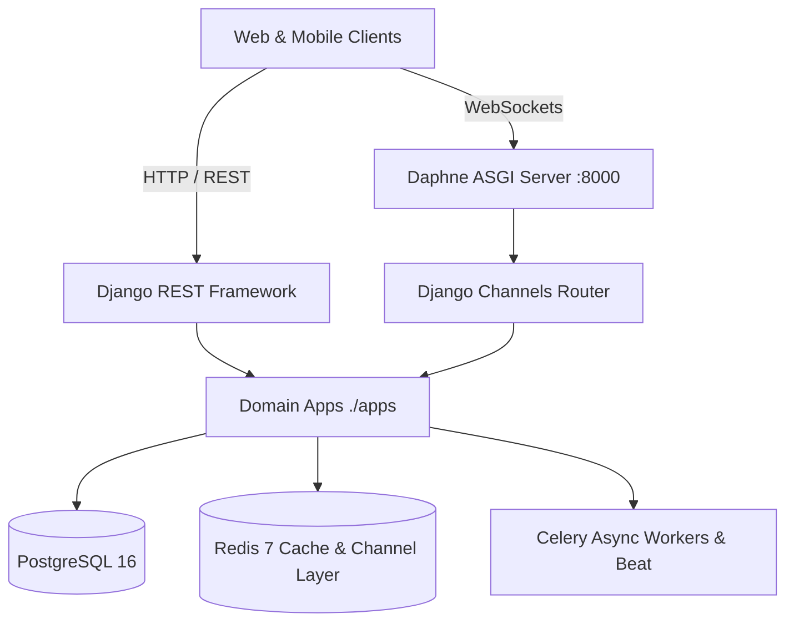

# Conductor Backend System (`conductor`)

## Overview
Conductor is the production backend source of truth for the LearningHub educational ecosystem. Built on Python 3.11+ and Django 5.0+ with Django REST Framework (DRF), Django Channels, and Daphne ASGI on port 8000. It manages relational persistence (PostgreSQL), in-memory caching and message pub/sub (Redis), Celery task execution, live WebSockets for proctoring and assessment telemetry, and cryptographic verification for candidate scorecards.

## System Architecture

## Structure & Subsystems

- [`apps/`](file:///C:/Users/shiva/Desktop/windows_app/conductor/apps/README.md): Modular business logic domains (45 total applications).
  - [`test_engine`](file:///C:/Users/shiva/Desktop/windows_app/conductor/apps/test_engine/README.md): Assessment orchestration, 3PL IRT adaptive engine, timer enforcement, and proctoring.
  - [`exams`](file:///C:/Users/shiva/Desktop/windows_app/conductor/apps/exams/README.md): Exam taxonomy, syllabus, PYQ vault, and revision content.
  - [`users`](file:///C:/Users/shiva/Desktop/windows_app/conductor/apps/users): Authentication, authorization, and student profiles.
  - [`core`](file:///C:/Users/shiva/Desktop/windows_app/conductor/apps/core): Shared base models, cryptographic signing, rate-limiting, and error handling.
- [`config/`](file:///C:/Users/shiva/Desktop/windows_app/conductor/config): Core Django configuration:
  - [`asgi.py`](file:///C:/Users/shiva/Desktop/windows_app/conductor/config/asgi.py): ASGI application entry point routing HTTP to Django DRF and WebSockets to `channels.routing.URLRouter`.
  - [`settings/`](file:///C:/Users/shiva/Desktop/windows_app/conductor/config/settings): Environment-split Django settings (`base.py`, `development.py`, `production.py`, `testing.py`).
  - [`urls.py`](file:///C:/Users/shiva/Desktop/windows_app/conductor/config/urls.py): Root URL dispatcher exposing `/api/v1/` routes.

## System Invariants
- **Port Authority**: Production Django/Daphne service binds to port `8000`. Dual-stack local proxies forward `/api/v1/` to `http://127.0.0.1:8000`.
- **Stateless Authentication**: HTTP endpoints require Bearer JWT access tokens validated via `rest_framework_simplejwt`. WebSocket connections extract JWT tokens from initial query strings or headers during the handshake phase.
- **Server-Authoritative Evaluation**: No client-submitted marks or scores are persisted directly. The server calculates all metrics, penalties, percentiles, and completion status.
- **Answer Key Concealment**: Question answers, option correctness, and solution rationale are strictly excluded from API serialization until the test attempt transitions to terminal state (`submitted`, `expired`).

## Verification
- Run test suite: `pytest conductor/`
- Run assessment tests: `pytest conductor/tests/test_test_engine.py`
- Validate system check: `python conductor/manage.py check`
